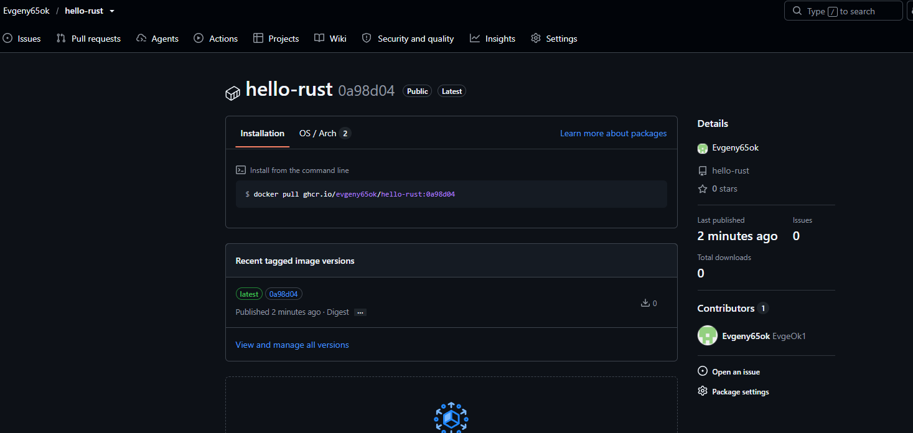
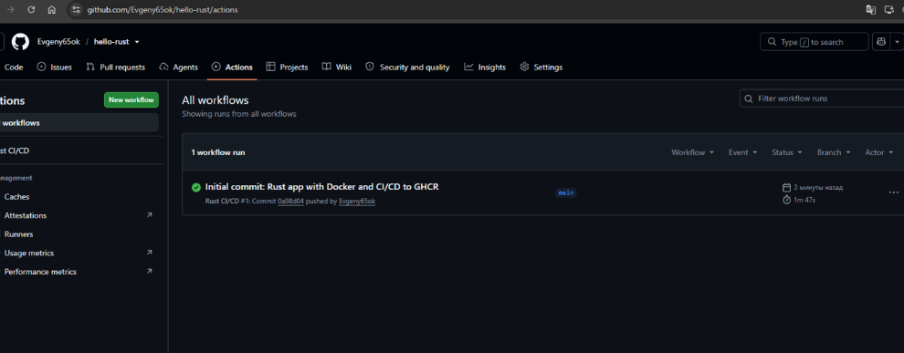

# hello-rust

Консольная программа на Rust, которая собирается в Docker-образ и публикуется
в **GitHub Container Registry**. Первый проект в коллекции: самый короткий
конвейер «проверки → сборка → публикация образа».

## Что проверяет пайплайн

| Шаг | Команда | Зачем |
|---|---|---|
| Форматирование | `cargo fmt --check` | единый стиль кода |
| Линтинг | `cargo clippy --all-targets -- -D warnings` | подсказки компилятора как ошибки |
| Тесты | `cargo test` | юнит- и интеграционные проверки |
| Сборка | `cargo build --release` | оптимизированный бинарник |
| Контейнер | `docker/build-push-action` | сборка образа и push в GHCR |

Образ уходит в реестр только при push в ветку `main` — на pull request
сборка идёт, но ничего не публикуется.

## Структура

```
.
├── Cargo.toml
├── Dockerfile          # многоступенчатая сборка: builder → debian:stable-slim
├── src/
│   ├── lib.rs          # greet() и sum_range() + тесты модуля
│   └── main.rs         # точка входа
└── tests/
    └── integration.rs  # проверки через публичный API библиотеки
```

## Запуск

```bash
# локально
cargo run --release
cargo test

# в контейнере
docker build -t hello-rust .
docker run --rm hello-rust
```

## Образ в GHCR

```bash
docker pull ghcr.io/spleiii/hello-rust:latest
docker run --rm ghcr.io/spleiii/hello-rust
```

## Пример вывода

```text
Hello from Rust in Docker! 🦀🐳
OS: linux
Arch: x86_64
Hello, Docker!
Sum 1..10 = 55
```

Аргументы командной строки выводятся отдельным списком:

```bash
docker run --rm hello-rust alpha beta
# Аргументы:
#   1: alpha
#   2: beta
```

## Результаты сборки





---

[← к списку заданий](https://github.com/SpleIII/Zadanie)
